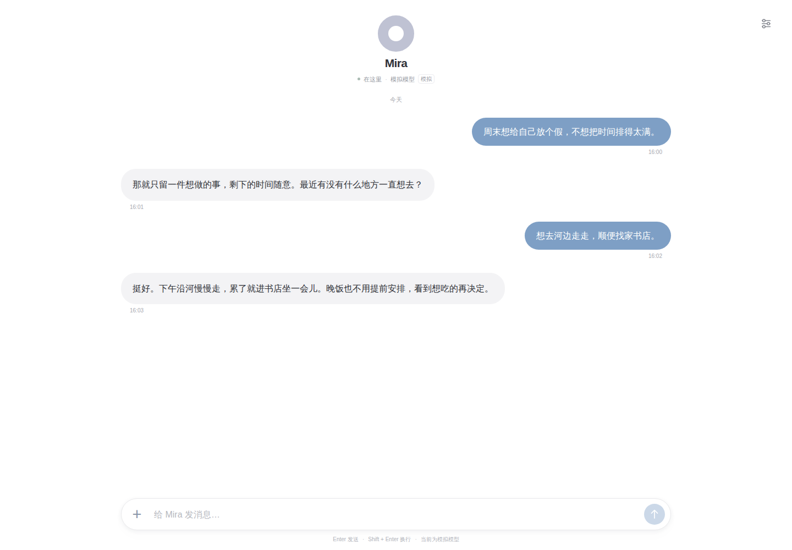

<h1 align="center">Mira</h1>

<p align="center">
  <a href="README.md">English</a> · <a href="README.zh-CN.md">简体中文</a> · <strong>日本語</strong> · <a href="README.ko.md">한국어</a>
</p>

<p align="center">
  <a href="LICENSE"></a>
  <a href="package.json"></a>
  <a href="package.json"></a>
  <a href="https://github.com/contrueCT/mira/actions/workflows/ci.yml?query=branch%3Amain"></a>
</p>

長期記憶を持ち、能力を広げながら、あなたと共にあり続けるパーソナルエージェント。

Mira は会話、共にした経験、進行中の作業を一つのタイムラインに残します。気軽に話しかけることも、具体的な仕事を任せることもできます。ページを閉じて戻ってきても、同じ Mira との時間が続きます。

この連続性は、より豊かで繊細な感情表現も支えます。Mira の設計では個性や反応を大切にし、会話を重ねる中で反応やあなたへの理解が自然につながり、共通の経験を通じて関係が育つことを目指しています。



## Mira にできること

- **そばにあり続けるパーソナルエージェント。** 会話と作業の文脈を保持し、再起動後の復元と自動圧縮に対応しています。外部イベントや予定された Wake をきっかけに作業を再開することもでき、あなたに連絡するかどうかは状況に応じて判断します。
- **自ら整理できる記憶。** 好み、大切な経験、長期的な理解を通常のファイルに記録し、条件が満たされると Dreaming によって記憶を整理します。ファイルは閲覧・編集でき、独立した Git リポジトリが変更を記録します。詳細を確かめたいときは元の履歴も参照できます。
- **個性と変化のある会話。** Mira は興味、疑問、ユーモア、異なる意見を表現し、会話中の感情の変化にも目を向けます。直近の反応は文脈に引き継がれ、関係についての重要な理解は長期記憶に残せます。
- **自然でスムーズな使い心地。** 日常の会話とタスクを一つのタイムラインで扱い、添付ファイルの送信や、作業中の要件追加・方針変更に対応します。Mira は生成リクエストが処理を譲るか、実行中のツールが完了した後に新しい入力を受け取ります。ツールやサブタスクの詳細は設定内の実行履歴にまとめ、メインのチャットは簡潔に保ちます。
- **広げ続けられる実行能力。** ファイル、検索、Shell、ターンをまたいで使えるターミナルを備え、独立した文脈を持つサブエージェントに作業を委任できます。文書、文字起こし、ブラウザー、Web アクセス用の Skills は必要に応じて利用します。Cordis が手動・生成拡張を管理し、ツール、イベントソース、文脈を追加できます。External SDK ではローカルプログラムを同じタイムラインに接続できます。
- **自分のモデルとデータ。** Web の設定からモデルの選択、API キーやカスタム接続の設定、Memory・拡張・履歴の管理ができ、共通の Web パスワードも設定できます。

ターミナルのプロセスは会話のターンをまたいで保持されますが、サービス再起動後には復元されません。Skills は説明と必要なスクリプトを提供し、ブラウザーや OCR などの依存関係は必要に応じて準備します。添付ファイルの処理能力はモデルとツールに依存します。[オンデマンドツールの説明 →](docs/development/runtime-tools.md)

## クイックスタート

Git、**Node.js 24.19.0–24.x**、**pnpm 11.28.4**、ローカルの PostgreSQL が必要です。CI は Node 24.21.0 と PostgreSQL 18.6 を使用します。Linux での PTY ビルドには Python 3、make、C++ コンパイラーも必要です。ターミナルは Linux/macOS に対応しています。

インストール前に、信頼できる個人用の実行環境であることを確認してください。Shell と拡張はホストアカウントの権限で実行され、製品レベルのサンドボックスはありません。

まず[ローカルインストールガイド](docs/development/local-web.md)に従って専用の `mira` データベースとユーザーを作成し、データベース認証を設定します。その後、以下を実行します。

```sh
git clone https://github.com/contrueCT/mira.git
cd mira
pnpm install --frozen-lockfile --ignore-scripts
pnpm terminal:prepare

# ガイドに従ってデータベース認証を設定し、パスワードをリポジトリや接続 URL に記載しないでください
MIRA_DATABASE_URL=postgres://mira@127.0.0.1:5432/mira pnpm start
```

`http://127.0.0.1:3210` を開き、右上の設定でモデルを選び、API キーを保存するとメッセージを送信できます。新しいデータベースは空のタイムラインから始まり、スクリーンショット内のデモ会話は読み込まれません。

- [インストール、起動、トラブルシューティング](docs/development/local-web.md)
- [モデル一覧、カスタム接続、推論レベル](docs/development/models.md)
- [モデル呼び出し不要の独立したシミュレーション環境](docs/development/local-web.md#4-手动模拟与日常数据分开)

## 実装を知る

TypeScript のモノレポです。Web には React/Vite と Fastify、ランタイムには Pi、永続化には PostgreSQL、拡張のライフサイクル管理には Cordis を使用しています。

| パス | 役割 |
| --- | --- |
| `apps/web`、`apps/server` | チャット画面、設定、API、起動時の組み立て |
| `packages/life`、`packages/context` | イベント、Wake キュー、単一のメイン認知ループ、連続した文脈 |
| `packages/cognition`、`packages/runtime-pi` | Runtime 契約、モデル実行、圧縮 |
| `packages/persistence`、`packages/workspace` | PostgreSQL の履歴、通常の記憶ファイル、Memory Git |
| `packages/extension-sdk`、`packages/extension-host` | 拡張の契約とライフサイクル |
| `packages/external-sdk` | ローカルの外部プログラムとの接続 |
| `tests`、`docs` | 回帰テスト、設計、決定、受け入れ検証の記録 |

- [アーキテクチャ概要](docs/architecture.md) · [設計全体 v0.5](docs/design/architecture-v0.5.md) · [実際の System Prompt v0.2](packages/runtime-pi/prompts/mira-system-v0.2.md)
- [拡張開発](packages/extension-host/README.md) · [External SDK](packages/external-sdk/README.md)
- [ツールチェーンとチェックコマンド](docs/development/toolchain.md) · [テストガイド](docs/development/local-web.md#5-自动化测试)
- [開発上の制約](docs/development/rules.md) · [開発ガイド](AGENTS.md) · [決定記録](docs/adr/README.md)

## ライセンス

Mira のオリジナルコードには [MIT License](LICENSE) が適用されます。同梱のサードパーティーコンテンツはそれぞれのライセンスを維持し、ルートのライセンスによって変更されません。[OpenAI の文書](skills/doc/LICENSE.txt)、[PDF](skills/pdf/LICENSE.txt)、[文字起こし Skills](skills/transcribe/LICENSE.txt)、[agent-browser](skills/agent-browser/LICENSE)、[拡張作成スキルの参照資料](skills/mira-extension-authoring/LICENSE.deepseek)。出典と変更履歴は[上流ソース一覧](skills/upstream-sources.json)を参照してください。依存パッケージには各自のライセンスが適用されます。

## 謝辞

- [Pi](https://github.com/earendil-works/pi) は、Mira が使用するモデルランタイム、ツール、文脈圧縮の基盤を提供しています。
- [OpenAI Codex](https://github.com/openai/codex) の関連機能の実装を参考にしました。
