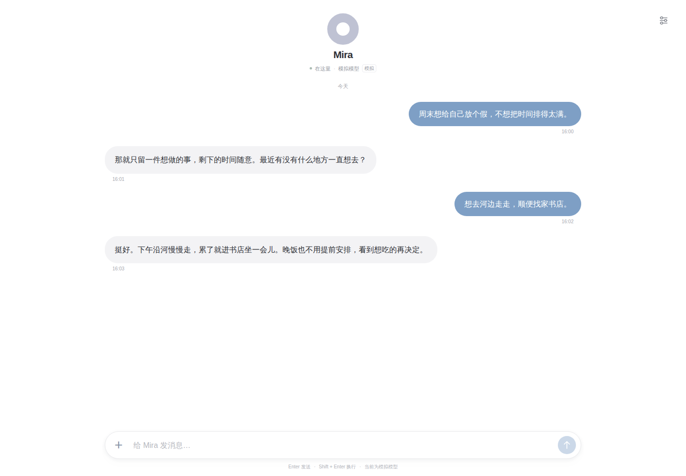

<h1 align="center">Mira</h1>

<p align="center">
  <a href="README.md">English</a> · <a href="README.zh-CN.md">简体中文</a> · <a href="README.ja.md">日本語</a> · <strong>한국어</strong>
</p>

<p align="center">
  <a href="LICENSE"></a>
  <a href="package.json"></a>
  <a href="package.json"></a>
  <a href="https://github.com/contrueCT/mira/actions/workflows/ci.yml?query=branch%3Amain"></a>
</p>

오래 기억하고, 능력을 넓혀 가며, 곁에 머무는 개인 에이전트.

Mira는 대화, 함께한 경험, 진행 중인 일을 하나의 타임라인에 간직합니다. 편하게 이야기를 나누거나 실제 작업을 맡길 수 있습니다. 페이지를 닫았다 돌아와도 같은 Mira와의 시간이 이어집니다.

이러한 연속성은 더 풍부하고 섬세한 감정 표현도 뒷받침합니다. Mira는 고유한 개성과 반응을 중요하게 생각하도록 설계되었습니다. 대화 속 반응과 사용자에 대한 이해가 자연스럽게 이어지고, 함께한 경험을 통해 관계가 발전하도록 지향합니다.



## Mira로 할 수 있는 일

- **계속 함께하는 개인 에이전트.** 대화와 작업의 맥락을 유지하고, 재시작 후 복원과 자동 압축을 지원합니다. 외부 이벤트나 예약된 Wake를 계기로 작업을 이어갈 수도 있으며, 사용자에게 연락할지는 현재 상황을 고려해 판단합니다.
- **스스로 정리할 수 있는 기억.** 일반 파일에 사용자의 취향, 중요한 경험, 장기적인 이해를 기록하고, 실행 조건이 충족되면 Dreaming으로 기억을 정리합니다. 파일을 직접 확인하고 편집할 수 있으며, 별도의 Git 저장소가 변경 사항을 기록합니다. 세부 사항을 확인해야 할 때는 원본 이력도 조회할 수 있습니다.
- **개성과 변화가 있는 대화.** Mira는 관심, 의문, 유머, 다른 의견을 표현하고 대화 속 감정 변화도 살핍니다. 최근 반응은 맥락에 이어지고, 관계에 대한 중요한 이해는 장기 기억에 남길 수 있습니다.
- **자연스럽고 매끄러운 사용 경험.** 일상 대화와 작업을 하나의 타임라인에서 다루며, 첨부 파일을 보내거나 작업 중에 요구 사항을 추가하고 방향을 바꿀 수 있습니다. Mira는 생성 요청이 실행을 양보하거나 현재 도구 실행이 끝난 뒤 새 입력을 받아들입니다. 도구와 하위 작업의 상세 내용은 설정의 실행 기록에 두어 메인 채팅을 간결하게 유지합니다.
- **계속 확장할 수 있는 실행 능력.** 파일, 검색, Shell, 대화 턴을 넘겨 사용할 수 있는 터미널 도구를 내장합니다. 독립된 맥락을 가진 하위 에이전트에게 작업을 맡기고, 문서·전사·브라우저·웹 접근용 Skills를 필요에 따라 사용할 수 있습니다. Cordis는 수동으로 작성하거나 생성한 확장을 관리하며 도구, 이벤트 소스, 맥락을 추가할 수 있게 합니다. External SDK로 로컬 프로그램을 같은 타임라인에 연결할 수도 있습니다.
- **자신의 모델과 데이터.** 웹 설정에서 모델 선택, API 키와 사용자 지정 연결 설정, Memory·확장·이력 관리가 가능하며 공용 웹 비밀번호도 설정할 수 있습니다.

터미널 프로세스는 대화 턴 사이에 유지되지만 서비스 재시작 후에는 복원되지 않습니다. Skills는 설명과 필요한 스크립트를 제공하며, 브라우저나 OCR 같은 의존성은 필요할 때 준비합니다. 첨부 파일 처리 능력은 모델과 도구에 따라 달라집니다. [필요 시 사용하는 도구 안내 →](docs/development/runtime-tools.md)

## 빠른 시작

Git, **Node.js 24.19.0–24.x**, **pnpm 11.28.4**, 로컬 PostgreSQL이 필요합니다. CI는 Node 24.21.0과 PostgreSQL 18.6을 사용합니다. Linux에서 PTY를 빌드하려면 Python 3, make, C++ 컴파일러도 필요합니다. 터미널은 Linux/macOS를 지원합니다.

설치하기 전에 신뢰할 수 있는 개인 실행 환경인지 확인하세요. Shell과 확장은 호스트 계정의 권한으로 실행되며 제품 수준의 샌드박스는 없습니다.

먼저 [로컬 설치 안내](docs/development/local-web.md)에 따라 전용 `mira` 데이터베이스와 사용자를 만들고 데이터베이스 인증을 설정하세요. 그다음 아래 명령을 실행합니다.

```sh
git clone https://github.com/contrueCT/mira.git
cd mira
pnpm install --frozen-lockfile --ignore-scripts
pnpm terminal:prepare

# 설치 안내에 따라 데이터베이스 인증을 설정하고 비밀번호를 저장소나 연결 URL에 넣지 마세요
MIRA_DATABASE_URL=postgres://mira@127.0.0.1:5432/mira pnpm start
```

`http://127.0.0.1:3210`을 열고 오른쪽 위 설정에서 모델을 선택한 뒤 API 키를 저장하면 메시지를 보낼 수 있습니다. 새 데이터베이스는 빈 타임라인으로 시작하며, 스크린샷의 데모 대화는 불러오지 않습니다.

- [전체 설치, 시작 및 문제 해결](docs/development/local-web.md)
- [모델 목록, 사용자 지정 연결 및 추론 수준](docs/development/models.md)
- [모델 호출이 필요 없는 독립 시뮬레이션 환경](docs/development/local-web.md#4-手动模拟与日常数据分开)

## 구현 살펴보기

TypeScript 모노레포입니다. 웹에는 React/Vite와 Fastify, 런타임에는 Pi, 영속 저장에는 PostgreSQL을 사용하며 확장 수명 주기는 Cordis가 관리합니다.

| 경로 | 역할 |
| --- | --- |
| `apps/web`, `apps/server` | 채팅 화면, 설정, API 및 시작 구성 |
| `packages/life`, `packages/context` | 이벤트, Wake 큐, 단일 메인 인지 루프 및 연속 맥락 |
| `packages/cognition`, `packages/runtime-pi` | Runtime 계약, 모델 실행 및 압축 |
| `packages/persistence`, `packages/workspace` | PostgreSQL 이력, 일반 기억 파일 및 Memory Git |
| `packages/extension-sdk`, `packages/extension-host` | 확장 계약 및 수명 주기 |
| `packages/external-sdk` | 로컬 외부 프로그램 연결 |
| `tests`, `docs` | 회귀 테스트, 설계, 결정 및 인수 검증 기록 |

- [아키텍처 개요](docs/architecture.md) · [전체 설계 v0.5](docs/design/architecture-v0.5.md) · [실제 System Prompt v0.2](packages/runtime-pi/prompts/mira-system-v0.2.md)
- [확장 개발](packages/extension-host/README.md) · [External SDK](packages/external-sdk/README.md)
- [도구 체인과 검사 명령](docs/development/toolchain.md) · [테스트 안내](docs/development/local-web.md#5-自动化测试)
- [개발 제약 사항](docs/development/rules.md) · [개발 지침](AGENTS.md) · [결정 기록](docs/adr/README.md)

## 라이선스

Mira의 자체 작성 코드는 [MIT License](LICENSE)를 따릅니다. 저장소에 포함된 타사 콘텐츠는 각자의 라이선스를 유지하며 루트 라이선스로 변경되지 않습니다. [OpenAI 문서](skills/doc/LICENSE.txt), [PDF](skills/pdf/LICENSE.txt), [전사 Skills](skills/transcribe/LICENSE.txt), [agent-browser](skills/agent-browser/LICENSE), [확장 작성 스킬 참고 자료](skills/mira-extension-authoring/LICENSE.deepseek)가 이에 해당합니다. 출처와 수정 기록은 [업스트림 목록](skills/upstream-sources.json)을 참고하세요. 의존 패키지는 각자의 라이선스를 따릅니다.

## 감사의 말

- [Pi](https://github.com/earendil-works/pi)는 Mira가 사용하는 모델 런타임, 도구, 맥락 압축의 기반을 제공합니다.
- [OpenAI Codex](https://github.com/openai/codex)의 관련 기능 구현을 참고했습니다.
