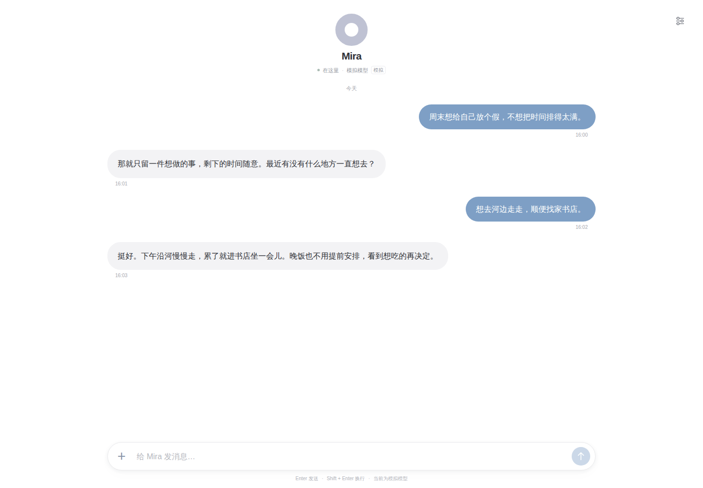

# Mira

一个持续存在的个人智能体。让对话、记忆和正在做的事，沿着同一条时间线延续。

Mira 保持连续的工作上下文，用普通文件保存长期记忆，也能使用工具、委派子任务和加载扩展。关掉页面再回来，继续和同一个 Mira 聊天。



*界面截图使用合成演示对话，不含个人数据。*

## 可以做什么

- **持续对话**：聊天与工作上下文持久化到 PostgreSQL，支持重启恢复、自动上下文压缩，以及任务进行中的补充输入。
- **长期记忆**：Memory 是可读、可编辑的普通文件，独立 Git 保存变更；Dreaming 在满足空闲与新经历条件时整理记忆。
- **动手处理任务**：文件读写、搜索、Shell 和跨轮次终端进程；支持聊天附件，以及按需使用的文档、转写、浏览器和联网 Skills。
- **委派子任务**：主 Mira 可启动独立上下文的子代理，并接收结果；在设置的运行记录中查看进度和详情。
- **扩展能力**：通过 Cordis 管理手工或生成扩展；External SDK 让本机程序提交事件、唤醒 Mira 或在时间线上发送通知。
- **自己的模型与数据**：网页设置中选择模型、配置 API Key 或自定义连接，管理 Memory、扩展与历史；可选共用网页密码。

终端进程可跨对话轮次保留，但不跨服务重启恢复。Skills 提供说明和必要脚本，浏览器、OCR 等依赖按需准备；附件的处理能力取决于模型与工具。[按需工具说明 →](docs/development/runtime-tools.md)

## 快速开始

需要 Git、**Node.js 24.19.0–24.x**、**pnpm 11.28.4** 和本机 PostgreSQL。CI 使用 Node 24.21.0 与 PostgreSQL 18.6。Linux 的 PTY 构建还需要 Python 3、make 和 C++ 编译器；终端支持 Linux/macOS。

安装前请确认这是可信的个人运行环境：Shell 和扩展使用宿主账户权限，没有产品级沙箱。

先按[本地安装指南](docs/development/local-web.md)创建独立的 `mira` 数据库和用户，并设置数据库认证。然后运行：

```sh
git clone https://github.com/contrueCT/mira.git
cd mira
pnpm install --frozen-lockfile --ignore-scripts
pnpm terminal:prepare

# 数据库认证按安装指南设置，不要把密码写入仓库或连接 URL
MIRA_DATABASE_URL=postgres://mira@127.0.0.1:5432/mira pnpm start
```

打开 `http://127.0.0.1:3210`，在右上角设置中选择模型并保存 API Key，即可发送消息。新数据库从空时间线开始，不会载入截图中的演示对话。

- [完整安装、启动与故障排查](docs/development/local-web.md)
- [模型目录、自定义连接与推理强度](docs/development/models.md)
- [无需模型调用的独立模拟环境](docs/development/local-web.md#4-手动模拟与日常数据分开)

## 数据与执行边界

请在可信的个人环境中使用。**文件、Shell 和扩展以宿主 OS 账户身份运行，没有产品级沙箱，也没有独立的工具审批引擎。** 模型根据对话和提示词判断操作或澄清；工作目录和 Cordis 都不是权限边界。

- 数据库、Memory、生成扩展、日志和凭据保存在源码仓库之外。`MIRA_HOME` 默认是 `~/.mira`；不要提交或公开自己的聊天、配置和运行数据。
- API Key 以明文保存在私有 `models.json`，通过文件权限保护，网页不会回填。它不是加密保险箱；同一 OS 账户下的工具与扩展可能读取它。
- 使用远程模型会向所选服务商发送模型请求，并可能产生费用。自定义远程连接应使用 HTTPS。
- 默认只监听 `127.0.0.1`，网页密码默认关闭。可选网页密码不提供传输加密；局域网或公网访问需自行配置访问边界，公网还需 HTTPS 反向代理。[访问配置 →](docs/adr/0033-web-password-access.md)
- 工具执行结果不明时会保留事实，不自动重放。上下文恢复不意味着外部副作用可以撤销。

## 开发状态

Mira 仍处于早期开发阶段。当前实现围绕 Architecture v0.5 与 Prompt v0.2 演进，不保证旧版本数据格式兼容；升级前请阅读对应变更说明并保留数据备份。

离线、数据库和浏览器测试验证执行机制；它们使用合成模型响应，不等于真实模型效果验收。完整生产 provider 联通与付费调用尚未验收，已有有限的[上下文压缩质量探针](docs/acceptance/compaction-continuity.md)单独记录其范围与局限。

### 本地检查

```sh
pnpm check                 # 类型、包边界、离线测试与构建
pnpm test:integration      # 需显式配置独立 mira_test 数据库
pnpm exec playwright install chromium
pnpm test:e2e              # 专用浏览器 fixture，不调用真实模型
```

集成测试会创建和清理测试 schema，不能指向日常数据库。完整命令和隔离要求见[工具链](docs/development/toolchain.md)及[测试指南](docs/development/local-web.md#5-自动化测试)。

文档用的合成、无个人信息展示图可放在 `docs/assets/`；其余浏览器测试输出、运行数据、Memory、密钥和构建产物不提交。

## 了解实现

TypeScript monorepo，Web 使用 React/Vite 与 Fastify，运行时接入 Pi，持久化使用 PostgreSQL，扩展生命周期由 Cordis 管理。

| 路径 | 职责 |
| --- | --- |
| `apps/web`、`apps/server` | 聊天页面、设置、API 与启动组装 |
| `packages/life`、`packages/context` | 事件、唤醒队列、单主认知循环与连续上下文 |
| `packages/cognition`、`packages/runtime-pi` | Runtime 契约、模型执行与压缩 |
| `packages/persistence`、`packages/workspace` | PostgreSQL 历史、普通记忆文件与 Memory Git |
| `packages/extension-sdk`、`packages/extension-host` | 扩展契约与生命周期 |
| `packages/external-sdk` | 本机外部程序接入 |
| `tests`、`docs` | 回归测试、设计、决策与验收记录 |

- [架构概览](docs/architecture.md) · [完整设计 v0.5](docs/design/architecture-v0.5.md) · [实际 System Prompt v0.2](packages/runtime-pi/prompts/mira-system-v0.2.md)
- [扩展开发](packages/extension-host/README.md) · [External SDK](packages/external-sdk/README.md)
- [开发约束](docs/development/rules.md) · [开发指引](AGENTS.md) · [决策记录](docs/adr/README.md)

## 许可证

Mira 的原创代码采用 [MIT License](LICENSE)。随仓库分发的第三方内容保留各自许可，不因根目录许可证而改变：[OpenAI 文档](skills/doc/LICENSE.txt)、[PDF](skills/pdf/LICENSE.txt)与[转写技能](skills/transcribe/LICENSE.txt)、[agent-browser](skills/agent-browser/LICENSE)、[扩展作者技能引用](skills/mira-extension-authoring/LICENSE.deepseek)。来源和修改记录见[上游清单](skills/upstream-sources.json)，依赖包遵循各自许可证。

## 致谢

- [Pi](https://github.com/earendil-works/pi) 提供了 Mira 使用的模型运行时、工具和上下文压缩基础。
- [OpenAI Codex](https://github.com/openai/codex) 为 Mira 的开发、代码审查和测试提供了帮助。
